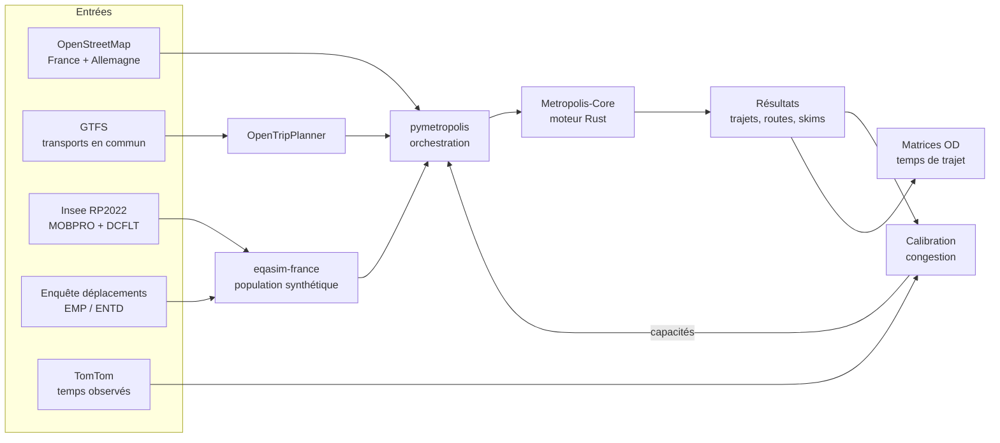

# Application de METROPOLIS2 au Bassin de Mobilités du Grand Est

Simulation du trafic routier à l'échelle du **Bassin de Mobilités du Grand Est** (817 communes du
Bas-Rhin et de la Moselle), avec le simulateur agent-based
[METROPOLIS2](https://github.com/Metropolis2/Metropolis-Core) et son outil d'orchestration
[pymetropolis](https://github.com/Metropolis2/pymetropolis), à partir d'une population synthétique
générée par [eqasim-france](https://github.com/eqasim-org/eqasim-france).

Ce dépôt rassemble le travail réalisé pendant mon stage : scripts de préparation des données,
configurations de simulation, méthodologies et notes techniques, et une série d'exercices de
prise en main des données du projet.

> Les **données** (entrées et sorties de simulation, plusieurs Go) et le code amont
> (pymetropolis, Metropolis-Core, eqasim-france) ne sont **pas** inclus : voir
> [Données](#données).

---

## Sommaire

- [Contexte et objectifs](#contexte-et-objectifs)
- [Chiffres clés](#chiffres-clés)
- [Chaîne de modélisation](#chaîne-de-modélisation)
- [Travaux réalisés](#travaux-réalisés)
  - [1. Intégration des frontaliers vers l'Allemagne](#1-intégration-des-frontaliers-vers-lallemagne)
  - [2. Calibration des capacités routières sur la congestion observée](#2-calibration-des-capacités-routières-sur-la-congestion-observée)
  - [3. Matrices origine-destination de temps de trajet](#3-matrices-origine-destination-de-temps-de-trajet)
  - [4. Exercices de prise en main des données](#4-exercices-de-prise-en-main-des-données)
- [Contenu du dépôt](#contenu-du-dépôt)
- [Reproduire la chaîne](#reproduire-la-chaîne)
- [Données](#données)
- [Limites et pistes](#limites-et-pistes)
- [Documentation](#documentation)

---

## Contexte et objectifs

Le bassin de mobilités du Grand Est est un territoire **transfrontalier** : une part importante
de ses actifs travaille en Allemagne, principalement autour de deux corridors (Strasbourg ↔ Kehl /
Karlsruhe / Rastatt, et Sarreguemines / Forbach ↔ Sarrebruck). Une simulation qui s'arrête à la
frontière ignore ces déplacements et sous-estime la congestion sur les axes qui y mènent.

Objectifs du stage :

1. **Mettre en place la chaîne complète** eqasim-france → pymetropolis → METROPOLIS2 sur le bassin
   (réseau routier OSM, transports en commun GTFS, population synthétique, choix modal, choix de
   l'heure de départ, 100 itérations de simulation).
2. **Intégrer les travailleurs frontaliers vers l'Allemagne**, absents de la population
   synthétique standard, ainsi que le réseau routier allemand correspondant.
3. **Calibrer les capacités routières** pour que la congestion simulée corresponde à la
   congestion observée (TomTom).
4. **Produire des matrices OD** de temps de trajet (free-flow et congestionnés) entre communes.

## Chiffres clés

| | |
|---|---|
| Communes françaises simulées | **817** (Bas-Rhin 67 + Moselle 57) |
| Communes allemandes ajoutées | **168** (8 Kreise frontaliers) |
| Frontaliers vers l'Allemagne (RP2022, pondéré) | **29 962**, dont **25 514 (85,2 %)** couverts |
| Frontaliers dans la population synthétique | **31 621** personnes |
| Échantillon simulé | 20 % de la population (`simulation_ratio = 0.2`) |
| Itérations de simulation | **100** (≈ 1 min 30 – 2 min par itération) |
| Temps de calcul du run complet | **5 h 28** |
| Trajets domicile → travail vers l'Allemagne (simulés) | **6 713** (+6 % vs attendu) |

## Chaîne de modélisation



- **eqasim-france** génère une population synthétique (ménages, personnes, chaînes d'activités)
  à partir du recensement et d'une enquête ménages-déplacements.
- **pymetropolis** importe le réseau routier OSM, construit la demande, appelle OpenTripPlanner
  pour les transports en commun, puis pilote le moteur **Metropolis-Core** sur 100 itérations
  (choix modal Logit, choix d'heure de départ ContinuousLogit, congestion par goulots
  d'étranglement).
- Les configurations utilisées sont dans [`config/`](config/).

## Travaux réalisés

### 1. Intégration des frontaliers vers l'Allemagne

📄 [Méthodologie complète](docs/methodologie_frontaliers_allemagne.md)

Dans le fichier MOBPRO de l'Insee, un actif travaillant à l'étranger a `DCLT = 99999` : sa
commune de travail est hors du référentiel français, et eqasim-france écartait ces lignes. Les
frontaliers disparaissaient donc de la simulation.

Démarche :

1. **Chiffrage** : estimation de 30 000 à 42 000 frontaliers à partir d'une étude Insee, puis
   confirmation avec la donnée réelle RP2022 (champ `DCFLT`) : **29 962** personnes pondérées,
   319 communes allemandes de destination.
2. **Périmètre** : restriction aux **8 Kreise** qui concentrent le flux (Ortenaukreis, Rastatt,
   Karlsruhe, Baden-Baden, Germersheim, Sarrebruck, Saarpfalz, Saarlouis). 37 % des codes
   suffisent à couvrir 85 % des personnes.
3. **Correspondance DCFLT → AGS** (code officiel des communes allemandes) par lecture des
   frontières administratives OSM (pyosmium), puis rapprochement des libellés en cascade : exact,
   préfixe, premier mot, similarité floue.
4. **Réseau routier transfrontalier** : fusion des extraits OSM France + Bade-Wurtemberg + Sarre
   + Rhénanie-Palatinat et découpe sur les 985 communes avec
   [`build_communes_osm.sh`](scripts/build_communes_osm.sh), avec dédoublonnage des objets OSM
   présents à la jonction des extraits.
5. **Patch d'eqasim-france** : conservation des lignes frontalières, remplacement du code de
   destination par le code AGS, et géocodage du lieu de travail au centroïde de la commune
   allemande (même repli que pour les communes françaises sans établissement SIRENE).
6. **Vérification de bout en bout** : comptages à chaque étape, contrôle des coordonnées, et
   destinations simulées concentrées sur les corridors attendus (Kehl, Sarrebruck, Rastatt,
   Offenburg…).

### 2. Calibration des capacités routières sur la congestion observée

📄 [Bilan détaillé](docs/calibration_congestion_bilan.md)

La capacité de chaque type de route (13 catégories : `motorway`, `trunk`, `primary`…) détermine
à partir de quand la route sature. La calibration ajuste ces capacités pour que le temps perdu
en congestion dans la simulation corresponde à celui mesuré par TomTom. Contrainte : ne pas
modifier le code de pymetropolis. La calibration est donc un pipeline de scripts externes :

1. **Collecte TomTom** de trajets aléatoires à des heures aléatoires (temps avec et sans trafic).
2. **Map-matching** des trajets sur le graphe routier du bassin.
3. **Rejeu de chaque trajet** sur les fonctions de temps de parcours de la dernière simulation,
   pour mesurer la congestion simulée imputable à chaque catégorie de route.
4. **Régression Ridge** de la congestion observée sur la congestion simulée, puis mise à jour
   `capacité / δ`, avec garde-fous (bornes, lissage, seuils d'observations et de signal).
5. **Itération** : nouvelle simulation avec les capacités mises à jour.

Résultat principal : la non-convergence de certaines catégories (`trunk`) vient d'une
**colinéarité structurelle** (par exemple `motorway` et `motorway_link` apparaissent ensemble
sur ~90 % des trajets), pas d'un manque d'observations. Les pistes de correction sont décrites
dans le bilan.

### 3. Matrices origine-destination de temps de trajet

📄 [Conception du Step pymetropolis](docs/pymetropolis_step_matrices_od.md) ·
[Mémo médoïde vs trajets réels](docs/memo_matrice_od_medoide_vs_trajets_reels.md) ·
[Guide de codage](docs/pymetropolis_partie_c_d_guide_codage.md)

[`compute_travel_times.py`](scripts/compute_travel_times.py) calcule, pour chaque paire de
communes, un temps de trajet en voiture, en free-flow ou en congestionné (à partir des fonctions
de temps de parcours de la simulation). Chaque commune est représentée par un nœud **médoïde**
du réseau routier.

Les documents associés analysent l'architecture de pymetropolis (v0.11.0) pour intégrer ce
calcul comme un `Step` natif, et comparent l'approche médoïde-à-médoïde à une agrégation des
trajets réellement simulés.

### 4. Exercices de prise en main des données

📁 [`docs/exercices/`](docs/exercices/)

Série de 7 thèmes au format des sujets de l'École 42 (objectif, contraintes, recherche sourcée,
grille d'auto-correction), pour apprendre à retrouver, inspecter et analyser seul les données
du projet avec **polars** et **geopandas** :

| Thème | Sujet |
|---|---|
| 0 | [Prise en main des librairies](docs/exercices/theme0_librairies.md) (polars, lazy API, jointures, fenêtres, CRS) |
| 1 | [Données d'entrée](docs/exercices/theme1_donnees_entree.md) (MOBPRO, DCFLT, IPONDI, OSM) |
| 2 | [Population synthétique](docs/exercices/theme2_population_synthetique.md) (sorties eqasim-france) |
| 3 | [Résultats de simulation](docs/exercices/theme3_resultats_simulation.md) (sorties pymetropolis) |
| 4 | [Statistiques de vérification](docs/exercices/theme4_statistiques_verification.md) |
| 5 | [Cartographie et graphiques](docs/exercices/theme5_cartographie.md) |
| 6 | [Mini-projet de synthèse](docs/exercices/theme6_mini_projet.md) |

Les dossiers `themeN/exNN/` contiennent mes réponses aux thèmes 0 à 2.

## Contenu du dépôt

```
.
├── config/
│   ├── config-bassin.toml         # config pymetropolis du bassin (simulation à 20 %)
│   └── config-bassin2021.toml     # variante millésime 2021 (simulation à 10 %)
├── scripts/
│   ├── build_communes_osm.sh      # fusion d'extraits OSM + découpe sur une liste de communes (INSEE/AGS)
│   ├── extract_communes.py        # polygones OSM des communes du bassin → GeoJSON
│   ├── build_extract_polygon.py   # polygone d'extraction (union des communes + marge de 10 km)
│   └── compute_travel_times.py    # matrice OD de temps de trajet (médoïdes, free-flow / congestionné)
└── docs/
    ├── methodologie_frontaliers_allemagne.{md,pdf}
    ├── calibration_congestion_bilan.{md,pdf}
    ├── pymetropolis_step_matrices_od.{md,pdf}
    ├── pymetropolis_exercices_partie_a.md
    ├── pymetropolis_partie_c_d_guide_codage.md
    ├── memo_matrice_od_medoide_vs_trajets_reels.{md,pdf}
    ├── journal-debug-simulation.md   # erreurs rencontrées pendant les runs et correctifs
    ├── reponses.md                   # réponses aux exercices pymetropolis (partie A)
    ├── figures/
    └── exercices/                    # exercices thèmes 0 à 6 + réponses
```

## Reproduire la chaîne

### Prérequis

- Linux, Python ≥ 3.12 avec [uv](https://docs.astral.sh/uv/), Rust (cargo) pour compiler
  Metropolis-Core, Java pour OpenTripPlanner
- [`osmium-tool`](https://osmcode.org/osmium-tool/) (pour `build_communes_osm.sh`), `pyosmium`,
  `geopandas`, `polars`
- Une machine bien dotée en mémoire : le run complet à 20 % tient en quelques heures, mais un
  run à 50 % a saturé la mémoire d'un serveur partagé

### Étapes

```bash
# 1. Récupérer le code amont à la racine du dépôt (chemins relatifs attendus par config/*.toml)
git clone https://github.com/Metropolis2/Metropolis-Core
git clone https://github.com/Metropolis2/pymetropolis
(cd Metropolis-Core && cargo build --release)
(cd pymetropolis && uv sync)

# 2. Construire le réseau OSM du bassin (France + Allemagne)
./scripts/build_communes_osm.sh \
    --csv communes_bassin.csv \
    --pbf grand-est-latest.osm.pbf baden-wuerttemberg-latest.osm.pbf \
          saarland-latest.osm.pbf rheinland-pfalz-latest.osm.pbf \
    --output bassin/data/bassin_mobilite_ge_sgp2026.osm.pbf

# 3. Polygones des communes et zone de simulation
python scripts/extract_communes.py
python scripts/build_extract_polygon.py

# 4. Générer la population synthétique avec eqasim-france (départements 67 et 57),
#    sortie dans bassin/data/output_eqasim/

# 5. Lancer OpenTripPlanner sur le port 8080, puis la simulation
uv run --project pymetropolis pymetropolis config/config-bassin.toml

# 6. Matrice OD de temps de trajet
python scripts/compute_travel_times.py
```

Les chemins d'entrée et de sortie sont définis en tête de chaque script et dans
`config/*.toml` : adapte-les à ton arborescence.

## Données

Aucune donnée n'est versionnée (volumétrie et licences). Sources utilisées :

| Donnée | Source |
|---|---|
| Réseau routier | [OpenStreetMap](https://www.openstreetmap.org/), extraits [Geofabrik](https://download.geofabrik.de/) (Grand Est, Bade-Wurtemberg, Sarre, Rhénanie-Palatinat) |
| Mobilités professionnelles | [Insee, RP2022, fichier détail MOBPRO](https://www.insee.fr/) |
| Estimation des flux frontaliers | Insee Analyses Grand Est n°144 et n°167 |
| Liste des communes du bassin | Bassin de Mobilités Grand Est (SGP 2026) |
| Enquêtes déplacements | EMP / ENTD (via eqasim-france) |
| Transports en commun | Flux GTFS des réseaux du bassin |
| Temps de trajet observés | API TomTom Routing |

## Limites et pistes

- **Frontaliers** : 14,8 % du flux vers l'Allemagne (Fribourg, Mannheim, Stuttgart…) reste hors
  périmètre. Les lieux de travail allemands sont placés au centroïde de la commune, faute de
  registre d'établissements équivalent à SIRENE. Le run frontaliers utilise l'enquête ENTD au
  lieu de l'EMP.
- **Calibration** : la colinéarité entre catégories de routes empêche la convergence. Pistes :
  fusionner les paires corrélées (`motorway` + `motorway_link`, `trunk` + `trunk_link`),
  renforcer la régularisation, collecter davantage de trajets courts.
- **Matrices OD** : intégrer le calcul comme `Step` natif de pymetropolis, et comparer avec une
  agrégation des trajets réellement simulés.

## Documentation

| Document | Contenu |
|---|---|
| [methodologie_frontaliers_allemagne.md](docs/methodologie_frontaliers_allemagne.md) | Intégration des frontaliers : chiffrage, matching DCFLT → AGS, patch eqasim-france, vérification |
| [calibration_congestion_bilan.md](docs/calibration_congestion_bilan.md) | Pipeline de calibration TomTom, résultats et problèmes ouverts |
| [pymetropolis_step_matrices_od.md](docs/pymetropolis_step_matrices_od.md) | Architecture de pymetropolis et plan d'ajout d'un Step « matrices OD » |
| [memo_matrice_od_medoide_vs_trajets_reels.md](docs/memo_matrice_od_medoide_vs_trajets_reels.md) | Médoïde-à-médoïde vs agrégation des trajets simulés |
| [journal-debug-simulation.md](docs/journal-debug-simulation.md) | Journal chronologique des erreurs de simulation et de leurs correctifs |
| [exercices/](docs/exercices/README.md) | Parcours d'exercices sur les données du projet |

---

Auteur : [@SonOfMaaJo](https://github.com/SonOfMaaJo) ·
[vnaoussi-djoumessi.com](https://vnaoussi-djoumessi.com)
