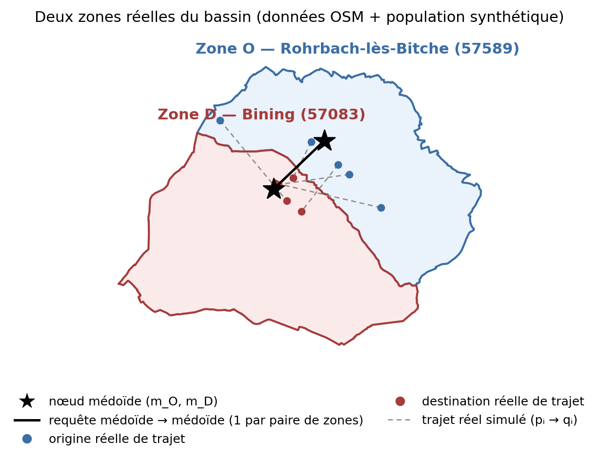

# Mémo : calcul de la matrice OD congestionnée, médoïde-à-médoïde vs. agrégation des trajets réels

## Schéma

*Illustration construite à partir de données réelles du projet : les polygones sont deux communes voisines du bassin (Rohrbach-lès-Bitche → Bining, Moselle), les points d'origine/destination sont un échantillon de vrais trajets de la population synthétique, et les nœuds médoïdes sont calculés géométriquement (point minimisant la somme des distances aux autres points de la même zone) à partir de l'ensemble des points de trajets réels situés dans chaque zone. Il s'agit d'une approximation illustrative, le vrai médoïde du réseau routier sera calculé sur les nœuds du graphe routier.*

## 1. Approche actuelle : médoïde-à-médoïde

Pour chaque zone (commune), on calcule un unique nœud représentatif du réseau routier, le médoïde, défini comme le nœud, parmi les nœuds du réseau situés dans la zone, qui minimise la somme des distances aux autres nœuds de cette même zone.

Pour une paire de zones (O, D), on effectue une seule requête de routing entre le médoïde de O (`m_O`) et le médoïde de D (`m_D`), sans fixer d'heure de départ. Le moteur de routing renvoie une fonction affine par morceaux `tt_{O,D}(t)`, donnant le temps de trajet congestionné pour un départ à l'instant `t`.

On restreint cette fonction à la tranche horaire d'intérêt `[τ_start, τ_end]`, ce qui donne un ensemble de points de rupture `t_1, …, t_n` avec `tt_i = tt_{O,D}(t_i)`. Le temps de trajet représentatif de la paire (O, D) est la médiane de ces points :

$$
\mathrm{med}_{\text{médoïde}}(O, D) = \mathrm{médiane}\big(\{tt_1, \dots, tt_n\}\big)
$$

*Remarque* : cette médiane est calculée sur l'échantillon des points de rupture de la fonction, pas sur une pondération continue du temps. Une version plus rigoureuse (médiane pondérée par la durée) consiste à trouver `m*` tel que :

$$
\frac{1}{\tau_{end}-\tau_{start}} \int_{\tau_{start}}^{\tau_{end}} \mathbb{1}\big[tt_{O,D}(t) \le m^*\big]\, dt = \frac{1}{2}
$$

Propriétés : une requête garantie par paire de zones, quel que soit le niveau de demande réelle entre les deux zones. C'est une approximation géométrique/réseau, indépendante de l'échantillon de population synthétique utilisé.

## 2. Approche alternative : agrégation des trajets réels

Au lieu d'une requête virtuelle unique, on utilise les trajets réellement simulés de la population synthétique. Une fois la simulation exécutée à convergence, chaque trajet réel `k` dispose d'une heure de départ et d'une heure d'arrivée effectivement réalisées (`departure_time_k`, `arrival_time_k`), d'où un temps de trajet observé :

$$
tt_k = arrival\_time_k - departure\_time_k
$$

Pour une paire de zones (O, D) et une tranche horaire `[τ_start, τ_end]`, on définit l'ensemble des trajets réels concernés :

$$
K(O, D, \tau) = \left\{\, k \ : \
\begin{aligned}
&\mathrm{zone\_origine}(k) = O, \\
&\mathrm{zone\_destination}(k) = D, \\
&departure\_time_k \in [\tau_{start}, \tau_{end}]
\end{aligned}
\,\right\}
$$

et le temps de trajet représentatif de la paire est la médiane empirique sur cet ensemble :

$$
\mathrm{med}_{\text{réel}}(O, D) = \mathrm{médiane}\big(\{\, tt_k \ : \ k \in K(O, D, \tau) \,\}\big)
$$

Propriétés : aucune nouvelle requête de routing n'est nécessaire, on relit des résultats déjà produits par la simulation. La zone d'origine/destination de chaque trajet réel est obtenue par un rattachement spatial (point dans polygone) des coordonnées réelles de trajet aux zones, réutilisant les zones déjà définies pour l'approche médoïde (donc valable aussi bien pour les communes françaises qu'allemandes du bassin transfrontalier).

## 3. Implications d'un changement d'approche

| | Médoïde-à-médoïde | Trajets réels agrégés |
|---|---|---|
| Couverture | Garantie : une valeur pour chaque paire de zones | Peut être incomplète : certaines paires peu fréquentées peuvent n'avoir aucun trajet réel dans la tranche horaire (surtout avec un taux d'échantillonnage de la population réduit) |
| Coût de calcul | Une requête de routing par paire de zones | Négligeable : une jointure spatiale + une agrégation sur des fichiers déjà produits, aucune requête supplémentaire |
| Nature de la mesure | Sonde contrôlée du réseau, indépendante de la demande réelle | Mesure empirique conditionnée à l'échantillon de population simulé et aux heures de départ réellement choisies par les agents (elles-mêmes issues d'un modèle de choix, donc non uniformément réparties dans la journée) |
| Réalisme | Approximation géométrique (le médoïde peut ne pas être représentatif de la distribution réelle des déplacements dans la zone) | Reflète la distribution spatiale et temporelle réelle de la demande simulée |
| Robustesse aux zones peu peuplées | Bonne (toujours un résultat) | Faible (résultat potentiellement absent ou bruité pour les paires à faible trafic) |
| Travail d'implémentation restant | Déjà en grande partie spécifié (requêtes de routing, format des résultats) | Un nouveau Step léger (rattachement spatial trajet → zone) ; réutilisation de fichiers de résultats de simulation déjà existants |

Option envisageable : une approche hybride, utiliser les trajets réels quand l'échantillon est suffisant pour une paire de zones donnée, et retomber sur le médoïde en complément pour les paires sans trajet réel observé dans la tranche horaire.
